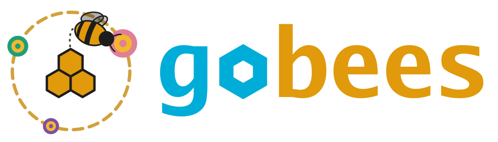

<div align="center">

<picture>
  <source media="(prefers-color-scheme: dark)" srcset="docs/logo/gobees-logo-dark.svg">
  <source media="(prefers-color-scheme: light)" srcset="docs/logo/gobees-logo-light.svg">
  
</picture>

[](https://github.com/peterpothmann/gobees-fast/actions/workflows/tests.yml)
[](https://github.com/peterpothmann/gobees-fast/actions/workflows/compare.yml)

</div>

`gobees-fast` is the optimized version of [gobees](https://github.com/peterpothmann/gobees), a port of [BEE-STEWARD](https://beehave-model.net/bee-steward-is-published/) ([Twiston-Davies et al. 2021](#ref-twiston-davies2021)) from `NetLogo` to `Go`, built on the [Ark](https://github.com/mlange-42/ark) entity component system. `BEE-STEWARD` is a research and decision support tool for land management that promotes bumblebee populations. It combines the bumblebee population model [Bumble-BEEHAVE](https://beehave-model.net/category/bumblebeehave/) ([Becher et al. 2018](#ref-becher2018)) with the landscape module [BEESCOUT](https://beehave-model.net/category/beescout/) ([Becher et al. 2016](#ref-becher2016)). It simulates colonies of six *Bombus* species and the cuckoo bumblebee *Psithyrus*, from queen emergence through foraging and brood rearing to hibernation, over several years. The bees forage in a nectar and pollen landscape built from maps, with the flowering period of each plant species. Agri-environment schemes, such as flower strips, and crop rotations can be applied to selected fields.

All credit for the scientific model, its development, and parameterisation belongs to the original authors and contributors of `BEE-STEWARD` and its component models.

> [!NOTE]
> gobees-fast is at its first step: apart from a longer daily output and the comparisons in [go/compare](go/compare/README.md), it is still the code of gobees (commit `40dc301`). The rest of this README describes gobees.

A graphical interface for gobees is available in [gobees-ui](https://github.com/peterpothmann/gobees-ui). It shows the landscape, the flowering calendar and the queens of a running simulation, and explains how the model works in a schematic animation.

## gobees and gobees-fast

- **gobees** stays as close as possible to the NetLogo code: same quirks, same variable and procedure names, same structure. It is meant for users who know BEE-STEWARD in NetLogo and want to move to Go, and who need to trace every result back to the NetLogo code.
- **gobees-fast** (this repository) starts as a copy of gobees, with its history. It is changed in small steps: dead code and unused data are removed, the data model is simplified, and the quirks of the NetLogo code ([trans/netlogo-findings.md](trans/netlogo-findings.md)) are fixed. It is meant for users who learn BEE-STEWARD from scratch, and for applications where performance matters most.

Every step is compared with an earlier commit of gobees-fast, first value by value, later by distributions over 100 seeds ([go/compare](go/compare/README.md)), and with NetLogo ([go/validation](go/validation/README.md)). Once a quirk that is active in the default run is fixed, the results differ from NetLogo, and gobees-fast is a modified model version, not BEE-STEWARD in Go.

`git diff upstream/main` shows every change against gobees, with the remote `upstream` set to <https://github.com/peterpothmann/gobees>.

## How the translation works

Each step follows the same order:

1. The NetLogo procedures of the step are annotated in [netlogo/__BEE-STEWARD_RC_ColourVersionMB.nlogo](netlogo/__BEE-STEWARD_RC_ColourVersionMB.nlogo). Annotations change comments only. Every procedure gets a header, and every step inside it gets a code such as `[UCOL-02]`.
2. Questionable behaviour of the NetLogo code is recorded in [trans/netlogo-findings.md](trans/netlogo-findings.md) and checked in NetLogo.
3. The step is translated to Go. Every system and function names the codes it translates, and every finding gets a test.
4. Where possible, gobees is compared with NetLogo (see [Validation](#validation)).

The reference is written in NetLogo 5.3.1.

## Repository layout


| Folder         | Content                                                         |
| -------------- | --------------------------------------------------------------- |
| `go/model`     | system order of setup and one simulated day                     |
| `go/sys`       | systems, one per NetLogo procedure                              |
| `go/comp`      | components of the entities (bees, colonies, foodsources, ...)   |
| `go/globals`   | global state of the model                                       |
| `go/params`    | parameters and the reader for NetLogo parameter files           |
| `go/util`      | functions that mirror NetLogo reporters                         |
| `go/obs`       | observers of the model output                              |
| `go/benchmark` | run time of NetLogo, gobees and gobees-fast                     |
| `go/compare`   | comparison with the reference commit (exact, statistical, speed) |
| `go/enum`      | castes, stages and activities as Go constants                   |
| `netlogo`      | the annotated NetLogo model and its input files                 |
| `trans`        | findings on the NetLogo code and the validation against NetLogo |

The layout follows [beecs](https://github.com/mlange-42/beecs).

## Usage

Requires Go 1.26 or later.

```shell
cd go
go run .
```

This runs the example farm (`netlogo/_SYSTEM_Example_Farm_Parameters.csv`) for 365 days and prints a short summary.

Other scenarios use the NetLogo input files. The parameter file names the species, flower species and habitat files. The map gives the name of the foodsources file (`X.png` → `X_Foodsources.txt`). As in NetLogo, these names are relative to one folder (`--dir`, default `../netlogo`, the folder of the `.nlogo`). The parameter file itself can lie anywhere.

```shell
go run . -p ../netlogo/_SYSTEM_Sussex1_Parameters.csv -m _SYSTEM_Sussex1.png   # Sussex instead of the example farm
go run . -p my_Parameters.csv -d path/to/inputs -s 3 --days 730                # own files, seed 3, 2 years
```

Unlike NetLogo, a missing parameter file is an error. NetLogo loads `_SYSTEM_Parameters.csv` instead.

The daily output can be written to a tab-separated file. It holds the totals of `OutputDailyProc` (colonies, queens, males, mean weights, ...), followed by brood, workers, stores, foraging trips, forager deaths, queens produced and the mean competition point date (`obs.DailyOutputExtended`). The CSV reporter of ark-tools adds one row at the end of every tick. Its first column `t` counts from 0, the column `ticks` holds the NetLogo ticks (1 on the first day). The totals of `OutputDailyProc` keep their NetLogo names.

```shell
go run . -o                     # writes go/daily_output.csv
go run . -f path/to/output.csv  # writes to any path, folders are created
go run . --help                 # all flags
```

Tests:

```shell
cd go
go test -timeout 30m ./...   # all tests, incl. the comparison with NetLogo (about 10 minutes)
go test -short ./...         # without the comparison with NetLogo
```

## Validation

Single runs of gobees and NetLogo cannot be compared, because NetLogo's random number sequence cannot be reproduced in Go. Instead, 100 NetLogo runs give quantiles per day for each compared quantity, and a Go test requires the median of 100 gobees runs to lie within the NetLogo 5–95 % band. The NetLogo results are embedded in the repository, so NetLogo does not have to be installed to run the tests.

The CI runs all tests on every pull request and on every push to `main`. In a pull request it commits the comparison report [go/validation/validation-report.md](go/validation/validation-report.md), with one plot per experiment, to the branch. Details on the experiments: [go/validation/README.md](go/validation/README.md).

## Comparison with the reference commit

The CI compares every pull request and every push to `main` with a reference commit of gobees-fast: value by value while a step must not change any random draw, otherwise by distributions over 100 seeds. It also times the current code against gobees. The results are in the summary of the run. Locally: `go/compare/run_compare.sh`. Details: [go/compare/README.md](go/compare/README.md).

## Benchmarks

In pull requests with the label `benchmark`, the CI runs the example farm in NetLogo 5.3.1, in gobees (the fork point) and in gobees-fast on the same runner, with the same seeds and days, and times each run. It commits the report [go/benchmark/benchmark-report.md](go/benchmark/benchmark-report.md) to the branch. How the comparison is kept fair: [go/benchmark/README.md](go/benchmark/README.md).

## References

- <a id="ref-becher2014"></a>Becher MA, Grimm V, Thorbek P, Horn J, Kennedy PJ, Osborne JL (2014) BEEHAVE: a systems model of honeybee colony dynamics and foraging to explore multifactorial causes of colony failure. *Journal of Applied Ecology* 51: 470–482. [doi:10.1111/1365-2664.12222](https://doi.org/10.1111/1365-2664.12222)
- <a id="ref-becher2016"></a>Becher MA, Grimm V, Knapp J, Horn J, Twiston-Davies G, Osborne JL (2016) BEESCOUT: A model of bee scouting behaviour and a software tool for characterizing nectar/pollen landscapes for BEEHAVE. *Ecological Modelling* 340: 126–133. [doi:10.1016/j.ecolmodel.2016.09.013](https://doi.org/10.1016/j.ecolmodel.2016.09.013)
- <a id="ref-becher2018"></a>Becher MA, Twiston-Davies G, Penny TD, Goulson D, Rotheray EL, Osborne JL (2018) Bumble-BEEHAVE: a systems model for exploring multifactorial causes of bumblebee decline at individual, colony, population and community level. *Journal of Applied Ecology* 55: 2790–2801. [doi:10.1111/1365-2664.13165](https://doi.org/10.1111/1365-2664.13165)
- <a id="ref-twiston-davies2021"></a>Twiston-Davies G, Becher MA, Osborne JL (2021) BEE-STEWARD: A research and decision-support software for effective land management to promote bumblebee populations. *Methods in Ecology and Evolution* 12: 1809–1815. [doi:10.1111/2041-210X.13673](https://doi.org/10.1111/2041-210X.13673)

## Related projects

- [BEE-STEWARD](https://beehave-model.net/bee-steward-is-published/): the original NetLogo model.
- [beecs](https://github.com/mlange-42/beecs): the honeybee model [BEEHAVE](https://beehave-model.net/) ([Becher et al. 2014](#ref-becher2014)) translated to Go with Ark. gobees took its layout and several ideas from it. Worth a look.
