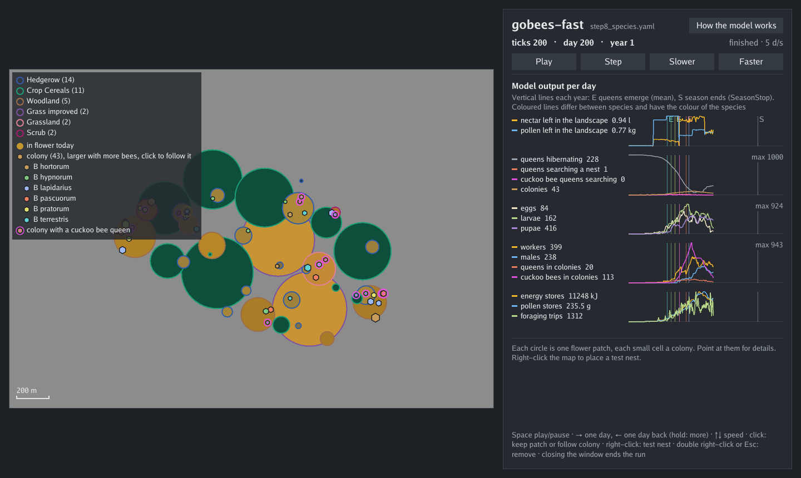

<div align="center">


[](https://github.com/peterpothmann/gobees-fast/actions/workflows/tests.yml)

</div>

`gobees-fast` is a fast version of the bumblebee model [BEE-STEWARD](https://beehave-model.net/bee-steward-is-published/) ([Twiston-Davies et al. 2021](#ref-twiston-davies2021)) in Go, built on the [Ark](https://github.com/mlange-42/ark) entity component system. It started as a copy of [gobees](https://github.com/peterpothmann/gobees), the faithful port of the NetLogo model, and was simplified and sped up in two phases:

1. changes that give the same output as gobees for the same seed, value by value
2. changes that alter the random numbers but not the distribution of the results, listed in [docs/changes.md](docs/changes.md)

On the example farm (365 days, median of 6 seeds, including reading the input) gobees-fast takes 82 ms, gobees 267 ms and NetLogo 16.7 s: about 200 times faster than NetLogo and 3 times faster than gobees ([go/benchmark/benchmark-report.md](go/benchmark/benchmark-report.md), as with commit 9ca7cf1).

## Quick start

Requires Go 1.26 or later.

```shell
cd go
# example farm, 365 days, prints a summary
go run .                                  
# also write the output into the folder output: output/example_farm/daily.csv
go run . -o output
# 10 runs with the seeds 1 to 10, 4 at a time (parallel runs)
go run . -o output -s 1 --repetitions 10 --threads 4
# own run file
go run . -c path/to/run.yaml
# columns of the daily output
go run . --list-columns
# write only these columns (ticks is always added)
go run . -o output --columns colonies,workers,eggs
```

To fix the columns in a run file instead of the flag:

```yaml
output:
  columns: [colonies, workers, eggs]
```

| Flag | Short | Meaning |
| --- | --- | --- |
| `--config PATH` | `-c` | run file (YAML). Default: the built-in example farm. Repeat `-c` for several run files. |
| `--seed N` | `-s` | seed of the first run, 1 or more |
| `--days N` | | days to run, 0 = no limit (the run ends when the population is extinct and `stopExtinct` is true) |
| `--repetitions N` | | number of runs (of each combination of the variations). Repetition i gets the seed `seed + i - 1`. |
| `--threads T` | | runs at the same time, each on one CPU core. `1` = one after the other. The output does not depend on it. |
| `--part I/N` | | run only the part I of N of the runs, for the jobs of an array on a cluster ([docs/usage.md](docs/usage.md#parts-on-a-cluster)) |
| `--output DIR` | `-o` | write the output into the folder `DIR/<name>` (`name`: key of the run file) |
| `--columns A,B,C` | | write only these columns |
| `--list-columns` | | print the columns of the daily output and exit |
| `--ui` | | show the run in a window while it runs (one run only; on Linux build with `-tags ui`) |
| `--help` | `-h` | show all flags |

Flags override the section `run` of the run file.

## Own run files

A run file (YAML) holds all inputs of a run and names its landscape files. Convert NetLogo input files into a run file with the converter:

```shell
cd tools/netlogo2gobees
go run . convert -d ../../netlogo -p ../../netlogo/_SYSTEM_Sussex1_Parameters.csv -m _SYSTEM_Sussex1.png -o sussex -n sussex
cd ../../go
go run . -c ../tools/netlogo2gobees/sussex/run.yaml
```

With `-o DIR`, each run file writes into `DIR/<name>` (key `name` of the run file) its daily output `daily.csv` and `provenance.yaml`. Running `provenance.yaml` with `-c` repeats the run byte for byte.

An optional section `variations` in the run file turns it into an experiment: every combination of the listed values runs.

```yaml
variations:
  - key: parameters.badgers
    values: [0, 2, 4]
```

To run the same parameters on many landscapes, each with its own crop rotation, give each landscape a folder with a site file and list the sites as a variation: `- sites: sites/*/site.yaml` ([docs/usage.md](docs/usage.md#sites)).

Details on run files, the converter, experiments, the daily output and the provenance: [docs/usage.md](docs/usage.md). All keys with unit and NetLogo name: [docs/names.md](docs/names.md).

## Watching a run

With `--ui` a run opens a window: map with flower patches and colonies, daily plots, colony and patch info, going back in time, and a debug tab that steps through a day part by part and bee turn by bee turn (time per part, entities, resources, the task choice of each bee). The run, its output and provenance are the same as without the window.

```shell
cd go
go run . --ui
go run . --ui -c compare/scenarios/step8_species.yaml -o output
```

On Linux the window is built only with the tag `ui` (`go run -tags ui . --ui`), because Ebitengine needs cgo and the X11 and OpenGL headers there. Without the tag, gobees-fast stays pure Go, e.g. on a cluster. On macOS cgo must be on (Xcode command line tools).



Details: [go/ui/README.md](go/ui/README.md).

## gobees and gobees-fast

| Version | For whom |
| --- | --- |
| **[gobees](https://github.com/peterpothmann/gobees)** | users who know BEE-STEWARD in NetLogo and need to trace every result back to the NetLogo code. Same behaviour, names and structure as NetLogo, including the findings in its code. |
| **gobees-fast** (this repository) | users who learn BEE-STEWARD from scratch or need speed. Dead code removed, data model simplified, names cleaned up, landscape in metres as YAML and CSV, many landscapes in one experiment. |

gobees-fast gives the same results as NetLogo in distribution, not run by run: the same seed gives other numbers than in NetLogo and gobees. The findings in the NetLogo code that act in the default run ([trans/netlogo-findings.md](trans/netlogo-findings.md)) are kept, so the model is still BEE-STEWARD. Only edge cases that change no result of the scenarios are fixed. [docs/changes.md](docs/changes.md) lists every difference to NetLogo and how it was checked. `git diff upstream/main` shows every change against gobees (remote `upstream` = [gobees](https://github.com/peterpothmann/gobees)).

## Tests and checks

```shell
cd go
go test -short ./...         # unit tests (fast)
go test -timeout 30m ./...   # including the comparison with NetLogo (about 10 minutes)
compare/run_compare.sh       # check of a step, as in the CI
```

The CI checks every pull request. It runs each scenario 100 times and compares the results with three versions:

| Compared with | How |
| --- | --- |
| previous step of gobees-fast | value by value, or by distributions if the step changes random draws |
| gobees | by distributions |
| NetLogo | median of gobees-fast within the 5–95 % band of 100 NetLogo runs |

One comment in the pull request shows the results. Details: [go/compare/README.md](go/compare/README.md), [go/validation/README.md](go/validation/README.md). In pull requests with the label `benchmark`, the CI also times NetLogo, gobees and gobees-fast ([go/benchmark/README.md](go/benchmark/README.md)).

### Profile-guided optimisation

`go build` in `go/` uses the CPU profile [go/default.pgo](go/default.pgo) to optimise the hot code paths ([profile-guided optimisation](https://go.dev/doc/pgo)). It changes no result. After larger changes of the model, renew the profile (example farm, 20 runs of 730 days):

```shell
cd go
GOBEES_PGO=$PWD/default.pgo go test -run '^TestWritePGOProfile$' -count=1 .
```

## Repository layout

| Folder | Content |
| --- | --- |
| `go/schedule` | order of the systems in setup and in one day |
| `go/sys` | 4 systems (Setup, Morning, Day, Evening) and their parts |
| `go/comp` | components of the entities (bees, colonies, foodsources, ...) |
| `go/globals` | state of the run |
| `go/params` | parameters and input (read-only during the run) |
| `go/input` | reader of the run files, built-in example farm |
| `go/obs` | observers of the model output |
| `go/compare` | check of each step |
| `go/validation` | comparison with NetLogo |
| `go/benchmark` | run time of NetLogo, gobees and gobees-fast |
| `go/enum` | castes, stages and activities |
| `go/day` | types for days: day of the run and day of the year |
| `go/event` | custom Ark events for the observers of the output |
| `go/examplefiles` | NetLogo example input files, copied verbatim for the import tests |
| `go/internal/check` | checks of the model state that the tests run every day |
| `go/ui` | window of `--ui` |
| `tools/netlogo2gobees` | converter of NetLogo input files into run files |
| `netlogo` | the annotated NetLogo model and its input files |
| `trans` | findings on the NetLogo code |

The layout follows [beecs](https://github.com/mlange-42/beecs).

## What the model does

BEE-STEWARD is a research and decision support tool for land management that promotes bumblebee populations. It combines the population model [Bumble-BEEHAVE](https://beehave-model.net/category/bumblebeehave/) ([Becher et al. 2018](#ref-becher2018)) with the landscape module [BEESCOUT](https://beehave-model.net/category/beescout/) ([Becher et al. 2016](#ref-becher2016)). It simulates colonies of six *Bombus* species and the cuckoo bumblebee *Psithyrus* over several years, from queen emergence through foraging and brood rearing to hibernation. The bumblebees forage in a nectar and pollen landscape built from maps. Flower strips and crop rotations can be applied to selected fields.

All credit for the scientific model belongs to the authors of BEE-STEWARD and its component models.

## References

- <a id="ref-becher2014"></a>Becher MA, Grimm V, Thorbek P, Horn J, Kennedy PJ, Osborne JL (2014) BEEHAVE: a systems model of honeybee colony dynamics and foraging to explore multifactorial causes of colony failure. *Journal of Applied Ecology* 51: 470–482. [doi:10.1111/1365-2664.12222](https://doi.org/10.1111/1365-2664.12222)
- <a id="ref-becher2016"></a>Becher MA, Grimm V, Knapp J, Horn J, Twiston-Davies G, Osborne JL (2016) BEESCOUT: A model of bee scouting behaviour and a software tool for characterizing nectar/pollen landscapes for BEEHAVE. *Ecological Modelling* 340: 126–133. [doi:10.1016/j.ecolmodel.2016.09.013](https://doi.org/10.1016/j.ecolmodel.2016.09.013)
- <a id="ref-becher2018"></a>Becher MA, Twiston-Davies G, Penny TD, Goulson D, Rotheray EL, Osborne JL (2018) Bumble-BEEHAVE: a systems model for exploring multifactorial causes of bumblebee decline at individual, colony, population and community level. *Journal of Applied Ecology* 55: 2790–2801. [doi:10.1111/1365-2664.13165](https://doi.org/10.1111/1365-2664.13165)
- <a id="ref-twiston-davies2021"></a>Twiston-Davies G, Becher MA, Osborne JL (2021) BEE-STEWARD: A research and decision-support software for effective land management to promote bumblebee populations. *Methods in Ecology and Evolution* 12: 1809–1815. [doi:10.1111/2041-210X.13673](https://doi.org/10.1111/2041-210X.13673)

## Related projects

- [BEE-STEWARD](https://beehave-model.net/bee-steward-is-published/): the original NetLogo model.
- [beecs](https://github.com/mlange-42/beecs): the honeybee model [BEEHAVE](https://beehave-model.net/) ([Becher et al. 2014](#ref-becher2014)) in Go with Ark. gobees took its layout and several ideas from it.
