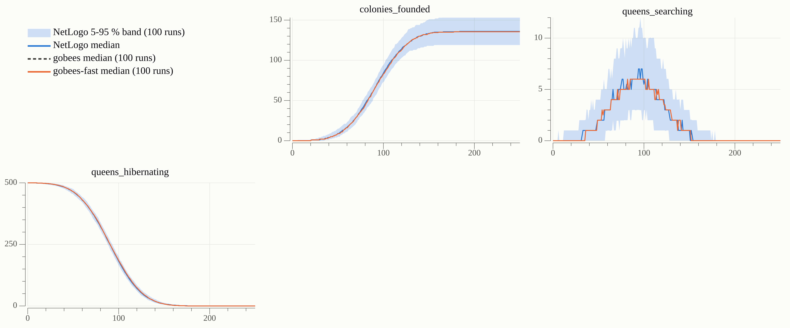
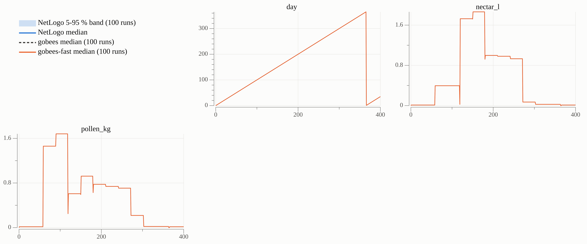

# Validation of gobees-fast

Band: the median of the gobees-fast runs lies within the 5-95 % band of the NetLogo runs on every compared day (enforced by the tests, weak). KS: two-sample Kolmogorov-Smirnov test of the run summaries (value at day 0, maximum and mean of every year) of gobees-fast against NetLogo and against gobees, Bonferroni-corrected per experiment and comparison (family alpha 0.05). Reported, not enforced. 100 runs per model and experiment. Details: go/validation/README.md.

| Experiment | Band: metrics inside on all days | KS vs NetLogo: significant tests | KS vs gobees: significant tests |
| --- | --- | --- | --- |
| `step3` | ✅ 9 of 9 | ✅ 0 of 15 | – no data |
| `step4a` | ✅ 3 of 3 | ✅ 0 of 15 | – no data |
| `step6` | ✅ 15 of 15 | ✅ 0 of 45 | – no data |
| Example farm, 3 years (`step7`) | ✅ 15 of 15 | ✅ 0 of 105 | – no data |
| Badgers (`step7_badgers`) | ✅ 16 of 16 | ✅ 0 of 112 | – no data |
| Crop rotation (`step7_crop`) | ✅ 16 of 16 | ✅ 0 of 112 | – no data |
| Individual-based colonies (`step8_ibm`) | ✅ 17 of 17 | – no data | – no data |
| Genetics (`step8_genetics`) | ✅ 16 of 16 | ✅ 0 of 80 | – no data |
| Several species (`step8_species`) | ✅ 22 of 22 | ✅ 0 of 110 | – no data |
| Weather and foraging mortality (`step8_weather`) | ✅ 16 of 16 | ✅ 0 of 80 | – no data |
| Other settings (`step8_settings`) | ✅ 17 of 17 | ✅ 0 of 85 | – no data |

## Steps 1 to 3: colony foundation in year 1

Experiment `go/validation/experiments/step3.xml`: example farm, 500 B. terrestris queens, 250 days. Setup values and queen traits are compared at step 0 only (later, NetLogo colonies die with their queen, which is not yet translated). Colony foundation and queen counts are compared at every step.

| Metric | Band: days inside | KS vs NetLogo | KS vs gobees |
| --- | --- | --- | --- |
| foodsources | ✅ 1 of 1 | ✅ 0 of 1 | – no data |
| masterpatches | ✅ 1 of 1 | ✅ 0 of 1 | – no data |
| nestsites | ✅ 1 of 1 | ✅ 0 of 1 | – no data |
| nestsite_area | ✅ 1 of 1 | ✅ 0 of 1 | – no data |
| mean_queen_weight | ✅ 1 of 1 | ✅ 0 of 1 | – no data |
| mean_emerging_date | ✅ 1 of 1 | ✅ 0 of 1 | – no data |
| colonies_founded | ✅ 251 of 251 | ✅ 0 of 3 | – no data |
| queens_searching | ✅ 251 of 251 | ✅ 0 of 3 | – no data |
| queens_hibernating | ✅ 251 of 251 | ✅ 0 of 3 | – no data |

## Step 4a: morning routine

Experiment `go/validation/experiments/step4a.xml`: example farm, 400 days. Day of the year, nectar and pollen available in the landscape. These values depend only on the landscape, so the NetLogo band is widened by a relative tolerance of 1e-9 (float sums in random order).

| Metric | Band: days inside | KS vs NetLogo | KS vs gobees |
| --- | --- | --- | --- |
| day | ✅ 401 of 401 | ✅ 0 of 5 | – no data |
| nectar_l | ✅ 401 of 401 | ✅ 0 of 5 | – no data |
| pollen_kg | ✅ 401 of 401 | ✅ 0 of 5 | – no data |

## Steps 4b to 6: colony dynamics in year 1

Experiment `go/validation/experiments/step6.xml`: example farm, 500 B. terrestris queens, 364 days, with brood, the daily activity queue and foraging. Both models run without QueensLeavingNestProc and UpdateSeasonalEventsProc (step 7). Compared at every step: the gobees median must lie in the NetLogo 5-95 % band. The table shows day 150, the middle of the colony season.

| Metric | Band: days inside | KS vs NetLogo | KS vs gobees |
| --- | --- | --- | --- |
| colonies | ✅ 365 of 365 | ✅ 0 of 3 | – no data |
| dead_colonies | ✅ 365 of 365 | ✅ 0 of 3 | – no data |
| eggs | ✅ 365 of 365 | ✅ 0 of 3 | – no data |
| larvae | ✅ 365 of 365 | ✅ 0 of 3 | – no data |
| pupae | ✅ 365 of 365 | ✅ 0 of 3 | – no data |
| workers | ✅ 365 of 365 | ✅ 0 of 3 | – no data |
| males | ✅ 365 of 365 | ✅ 0 of 3 | – no data |
| young_queens | ✅ 365 of 365 | ✅ 0 of 3 | – no data |
| energy_kJ | ✅ 365 of 365 | ✅ 0 of 3 | – no data |
| pollen_g | ✅ 365 of 365 | ✅ 0 of 3 | – no data |
| trips | ✅ 365 of 365 | ✅ 0 of 3 | – no data |
| switch_point | ✅ 365 of 365 | ✅ 0 of 3 | – no data |
| queen_production | ✅ 365 of 365 | ✅ 0 of 3 | – no data |
| nectar_left_l | ✅ 365 of 365 | ✅ 0 of 3 | – no data |
| pollen_left_kg | ✅ 365 of 365 | ✅ 0 of 3 | – no data |

## Step 7: the year cycle

### Example farm, 3 years

Experiment `go/validation/experiments/step7.xml`: example farm, 500 B. terrestris queens, 1095 days, the full model (NetLogo `Go`, gobees `model.Default`) with the year cycle: young queens leave the nest and hibernate, the season ends, the queens emerge again. Both run with StopExtinct? = false. Compared at every step: the gobees median must lie in the NetLogo 5-95 % band. The table shows day 515 (day 150 of year 2).

| Metric | Band: days inside | KS vs NetLogo | KS vs gobees |
| --- | --- | --- | --- |
| colonies | ✅ 1096 of 1096 | ✅ 0 of 7 | – no data |
| dead_colonies | ✅ 1096 of 1096 | ✅ 0 of 7 | – no data |
| colonies_founded | ✅ 1096 of 1096 | ✅ 0 of 7 | – no data |
| eggs | ✅ 1096 of 1096 | ✅ 0 of 7 | – no data |
| larvae | ✅ 1096 of 1096 | ✅ 0 of 7 | – no data |
| pupae | ✅ 1096 of 1096 | ✅ 0 of 7 | – no data |
| workers | ✅ 1096 of 1096 | ✅ 0 of 7 | – no data |
| males | ✅ 1096 of 1096 | ✅ 0 of 7 | – no data |
| young_queens | ✅ 1096 of 1096 | ✅ 0 of 7 | – no data |
| hibernating_queens | ✅ 1096 of 1096 | ✅ 0 of 7 | – no data |
| energy_kJ | ✅ 1096 of 1096 | ✅ 0 of 7 | – no data |
| pollen_g | ✅ 1096 of 1096 | ✅ 0 of 7 | – no data |
| trips | ✅ 1096 of 1096 | ✅ 0 of 7 | – no data |
| nectar_left_l | ✅ 1096 of 1096 | ✅ 0 of 7 | – no data |
| pollen_left_kg | ✅ 1096 of 1096 | ✅ 0 of 7 | – no data |

### Badgers

Experiment `go/validation/experiments/step7_badgers.xml`: as step 7 (example farm, 1095 days, full model), with 2 badgers (N_Badgers = 2). They live on the two Scrub patches of the example farm and dig up each colony within 735 m with p = 0.019 per day. Both run with StopExtinct? = false. Compared at every step: the gobees median must lie in the NetLogo 5-95 % band. The table shows day 515 (day 150 of year 2).

| Metric | Band: days inside | KS vs NetLogo | KS vs gobees |
| --- | --- | --- | --- |
| colonies | ✅ 1096 of 1096 | ✅ 0 of 7 | – no data |
| dead_colonies | ✅ 1096 of 1096 | ✅ 0 of 7 | – no data |
| colonies_founded | ✅ 1096 of 1096 | ✅ 0 of 7 | – no data |
| eggs | ✅ 1096 of 1096 | ✅ 0 of 7 | – no data |
| larvae | ✅ 1096 of 1096 | ✅ 0 of 7 | – no data |
| pupae | ✅ 1096 of 1096 | ✅ 0 of 7 | – no data |
| workers | ✅ 1096 of 1096 | ✅ 0 of 7 | – no data |
| males | ✅ 1096 of 1096 | ✅ 0 of 7 | – no data |
| young_queens | ✅ 1096 of 1096 | ✅ 0 of 7 | – no data |
| hibernating_queens | ✅ 1096 of 1096 | ✅ 0 of 7 | – no data |
| energy_kJ | ✅ 1096 of 1096 | ✅ 0 of 7 | – no data |
| pollen_g | ✅ 1096 of 1096 | ✅ 0 of 7 | – no data |
| trips | ✅ 1096 of 1096 | ✅ 0 of 7 | – no data |
| nectar_left_l | ✅ 1096 of 1096 | ✅ 0 of 7 | – no data |
| pollen_left_kg | ✅ 1096 of 1096 | ✅ 0 of 7 | – no data |
| badgers | ✅ 1096 of 1096 | ✅ 0 of 7 | – no data |

### Crop rotation

Experiment `go/validation/experiments/step7_crop.xml`: as step 7 (example farm, 1095 days, full model), with a crop rotation of two maps. On Day 365 the landscape is replaced: year 2 runs on `Example_Farm_PlotTest_Foodsources.txt` (36 flower patches), year 3 on the example farm again. Both run with StopExtinct? = false. Compared at every step: the gobees median must lie in the NetLogo 5-95 % band. The table shows day 515 (day 150 of year 2, on the second map).

| Metric | Band: days inside | KS vs NetLogo | KS vs gobees |
| --- | --- | --- | --- |
| colonies | ✅ 1096 of 1096 | ✅ 0 of 7 | – no data |
| dead_colonies | ✅ 1096 of 1096 | ✅ 0 of 7 | – no data |
| colonies_founded | ✅ 1096 of 1096 | ✅ 0 of 7 | – no data |
| eggs | ✅ 1096 of 1096 | ✅ 0 of 7 | – no data |
| larvae | ✅ 1096 of 1096 | ✅ 0 of 7 | – no data |
| pupae | ✅ 1096 of 1096 | ✅ 0 of 7 | – no data |
| workers | ✅ 1096 of 1096 | ✅ 0 of 7 | – no data |
| males | ✅ 1096 of 1096 | ✅ 0 of 7 | – no data |
| young_queens | ✅ 1096 of 1096 | ✅ 0 of 7 | – no data |
| hibernating_queens | ✅ 1096 of 1096 | ✅ 0 of 7 | – no data |
| energy_kJ | ✅ 1096 of 1096 | ✅ 0 of 7 | – no data |
| pollen_g | ✅ 1096 of 1096 | ✅ 0 of 7 | – no data |
| trips | ✅ 1096 of 1096 | ✅ 0 of 7 | – no data |
| nectar_left_l | ✅ 1096 of 1096 | ✅ 0 of 7 | – no data |
| pollen_left_kg | ✅ 1096 of 1096 | ✅ 0 of 7 | – no data |
| foodsources | ✅ 1096 of 1096 | ✅ 0 of 7 | – no data |

## Step 8: model branches the example farm does not use

### Individual-based colonies

Experiment `go/validation/experiments/step8_ibm.xml`: example farm, full model, 730 days, with the parameter file `step8_ibm_Parameters.csv`: COLONIES_IBM = 10, the first 10 colonies are individual-based [CCOL-05]. Both run with StopExtinct? = false. The table shows day 150.

| Metric | Band: days inside | KS vs NetLogo | KS vs gobees |
| --- | --- | --- | --- |
| colonies | ✅ 731 of 731 | – no data | – no data |
| dead_colonies | ✅ 731 of 731 | – no data | – no data |
| colonies_founded | ✅ 731 of 731 | – no data | – no data |
| eggs | ✅ 731 of 731 | – no data | – no data |
| larvae | ✅ 731 of 731 | – no data | – no data |
| pupae | ✅ 731 of 731 | – no data | – no data |
| workers | ✅ 731 of 731 | – no data | – no data |
| males | ✅ 731 of 731 | – no data | – no data |
| young_queens | ✅ 731 of 731 | – no data | – no data |
| hibernating_queens | ✅ 731 of 731 | – no data | – no data |
| energy_kJ | ✅ 731 of 731 | – no data | – no data |
| pollen_g | ✅ 731 of 731 | – no data | – no data |
| trips | ✅ 731 of 731 | – no data | – no data |
| nectar_left_l | ✅ 731 of 731 | – no data | – no data |
| pollen_left_kg | ✅ 731 of 731 | – no data | – no data |
| ibm_colonies | ✅ 731 of 731 | – no data | – no data |
| bee_agents | ✅ 731 of 731 | – no data | – no data |

### Genetics

Experiment `go/validation/experiments/step8_genetics.xml`: example farm, full model, 730 days, with the parameter file `step8_genetics_Parameters.csv`: SexLocus? = true (diploid males), UnlimitedMales? = false (a queen without a male dies). Both run with StopExtinct? = false. The table shows day 150.

| Metric | Band: days inside | KS vs NetLogo | KS vs gobees |
| --- | --- | --- | --- |
| colonies | ✅ 731 of 731 | ✅ 0 of 5 | – no data |
| dead_colonies | ✅ 731 of 731 | ✅ 0 of 5 | – no data |
| colonies_founded | ✅ 731 of 731 | ✅ 0 of 5 | – no data |
| eggs | ✅ 731 of 731 | ✅ 0 of 5 | – no data |
| larvae | ✅ 731 of 731 | ✅ 0 of 5 | – no data |
| pupae | ✅ 731 of 731 | ✅ 0 of 5 | – no data |
| workers | ✅ 731 of 731 | ✅ 0 of 5 | – no data |
| males | ✅ 731 of 731 | ✅ 0 of 5 | – no data |
| young_queens | ✅ 731 of 731 | ✅ 0 of 5 | – no data |
| hibernating_queens | ✅ 731 of 731 | ✅ 0 of 5 | – no data |
| energy_kJ | ✅ 731 of 731 | ✅ 0 of 5 | – no data |
| pollen_g | ✅ 731 of 731 | ✅ 0 of 5 | – no data |
| trips | ✅ 731 of 731 | ✅ 0 of 5 | – no data |
| nectar_left_l | ✅ 731 of 731 | ✅ 0 of 5 | – no data |
| pollen_left_kg | ✅ 731 of 731 | ✅ 0 of 5 | – no data |
| diploid_males | ✅ 731 of 731 | ✅ 0 of 5 | – no data |

### Several species

Experiment `go/validation/experiments/step8_species.xml`: example farm, full model, 730 days, with the parameter file `step8_species_Parameters.csv`: all 7 species, 150 queens of each Bombus species and 100 Psithyrus queens. Both run with StopExtinct? = false. The table shows day 150.

| Metric | Band: days inside | KS vs NetLogo | KS vs gobees |
| --- | --- | --- | --- |
| colonies | ✅ 731 of 731 | ✅ 0 of 5 | – no data |
| dead_colonies | ✅ 731 of 731 | ✅ 0 of 5 | – no data |
| colonies_founded | ✅ 731 of 731 | ✅ 0 of 5 | – no data |
| eggs | ✅ 731 of 731 | ✅ 0 of 5 | – no data |
| larvae | ✅ 731 of 731 | ✅ 0 of 5 | – no data |
| pupae | ✅ 731 of 731 | ✅ 0 of 5 | – no data |
| workers | ✅ 731 of 731 | ✅ 0 of 5 | – no data |
| males | ✅ 731 of 731 | ✅ 0 of 5 | – no data |
| young_queens | ✅ 731 of 731 | ✅ 0 of 5 | – no data |
| hibernating_queens | ✅ 731 of 731 | ✅ 0 of 5 | – no data |
| energy_kJ | ✅ 731 of 731 | ✅ 0 of 5 | – no data |
| pollen_g | ✅ 731 of 731 | ✅ 0 of 5 | – no data |
| trips | ✅ 731 of 731 | ✅ 0 of 5 | – no data |
| nectar_left_l | ✅ 731 of 731 | ✅ 0 of 5 | – no data |
| pollen_left_kg | ✅ 731 of 731 | ✅ 0 of 5 | – no data |
| colonies_B_terrestris | ✅ 731 of 731 | ✅ 0 of 5 | – no data |
| colonies_B_pascuorum | ✅ 731 of 731 | ✅ 0 of 5 | – no data |
| colonies_B_lapidarius | ✅ 731 of 731 | ✅ 0 of 5 | – no data |
| colonies_B_hortorum | ✅ 731 of 731 | ✅ 0 of 5 | – no data |
| colonies_B_pratorum | ✅ 731 of 731 | ✅ 0 of 5 | – no data |
| colonies_B_hypnorum | ✅ 731 of 731 | ✅ 0 of 5 | – no data |
| psithyrus | ✅ 731 of 731 | ✅ 0 of 5 | – no data |

### Weather and foraging mortality

Experiment `go/validation/experiments/step8_weather.xml`: example farm, full model, 730 days, with the parameter file `step8_weather_Parameters.csv`: Weather = "foragingHoursExample" (foraging hours per day of the year), ForagingMortalityModel = "low". Both run with StopExtinct? = false. The table shows day 150.

| Metric | Band: days inside | KS vs NetLogo | KS vs gobees |
| --- | --- | --- | --- |
| colonies | ✅ 731 of 731 | ✅ 0 of 5 | – no data |
| dead_colonies | ✅ 731 of 731 | ✅ 0 of 5 | – no data |
| colonies_founded | ✅ 731 of 731 | ✅ 0 of 5 | – no data |
| eggs | ✅ 731 of 731 | ✅ 0 of 5 | – no data |
| larvae | ✅ 731 of 731 | ✅ 0 of 5 | – no data |
| pupae | ✅ 731 of 731 | ✅ 0 of 5 | – no data |
| workers | ✅ 731 of 731 | ✅ 0 of 5 | – no data |
| males | ✅ 731 of 731 | ✅ 0 of 5 | – no data |
| young_queens | ✅ 731 of 731 | ✅ 0 of 5 | – no data |
| hibernating_queens | ✅ 731 of 731 | ✅ 0 of 5 | – no data |
| energy_kJ | ✅ 731 of 731 | ✅ 0 of 5 | – no data |
| pollen_g | ✅ 731 of 731 | ✅ 0 of 5 | – no data |
| trips | ✅ 731 of 731 | ✅ 0 of 5 | – no data |
| nectar_left_l | ✅ 731 of 731 | ✅ 0 of 5 | – no data |
| pollen_left_kg | ✅ 731 of 731 | ✅ 0 of 5 | – no data |
| foraging_period_s | ✅ 731 of 731 | ✅ 0 of 5 | – no data |

### Other settings

Experiment `go/validation/experiments/step8_settings.xml`: example farm, full model, 730 days, with the parameter file `step8_settings_Parameters.csv`: WinterMortality?, MergeHedges?, MinSizeFoodSources?, RemoveEmptyFoodSources?, KeepDeadColonies? = false, MaxHibernatingQueens = 150 (the limit takes effect on every 1 January, also on the first day). Both run with StopExtinct? = false. The table shows day 150.

| Metric | Band: days inside | KS vs NetLogo | KS vs gobees |
| --- | --- | --- | --- |
| colonies | ✅ 731 of 731 | ✅ 0 of 5 | – no data |
| dead_colonies | ✅ 731 of 731 | ✅ 0 of 5 | – no data |
| colonies_founded | ✅ 731 of 731 | ✅ 0 of 5 | – no data |
| eggs | ✅ 731 of 731 | ✅ 0 of 5 | – no data |
| larvae | ✅ 731 of 731 | ✅ 0 of 5 | – no data |
| pupae | ✅ 731 of 731 | ✅ 0 of 5 | – no data |
| workers | ✅ 731 of 731 | ✅ 0 of 5 | – no data |
| males | ✅ 731 of 731 | ✅ 0 of 5 | – no data |
| young_queens | ✅ 731 of 731 | ✅ 0 of 5 | – no data |
| hibernating_queens | ✅ 731 of 731 | ✅ 0 of 5 | – no data |
| energy_kJ | ✅ 731 of 731 | ✅ 0 of 5 | – no data |
| pollen_g | ✅ 731 of 731 | ✅ 0 of 5 | – no data |
| trips | ✅ 731 of 731 | ✅ 0 of 5 | – no data |
| nectar_left_l | ✅ 731 of 731 | ✅ 0 of 5 | – no data |
| pollen_left_kg | ✅ 731 of 731 | ✅ 0 of 5 | – no data |
| foodsources | ✅ 731 of 731 | ✅ 0 of 5 | – no data |
| queens_removed | ✅ 731 of 731 | ✅ 0 of 5 | – no data |

Plots: blue, NetLogo median and 5-95 % band; dark grey, dashed, gobees median; orange, gobees-fast median; x axis: day.
